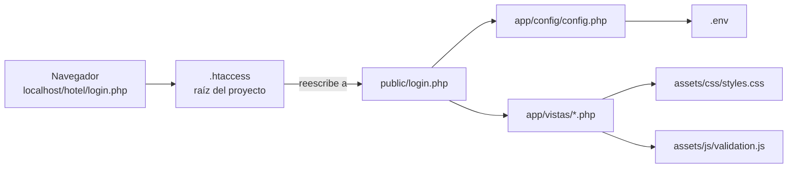
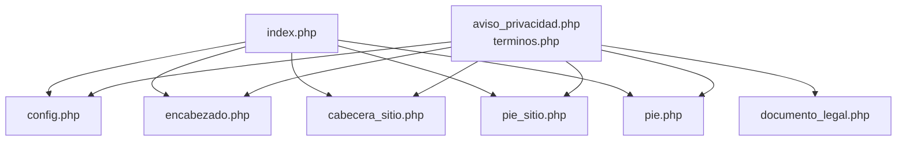
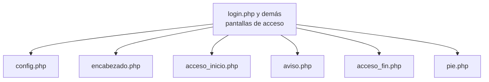
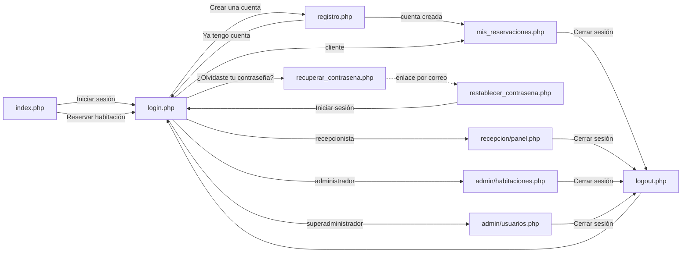
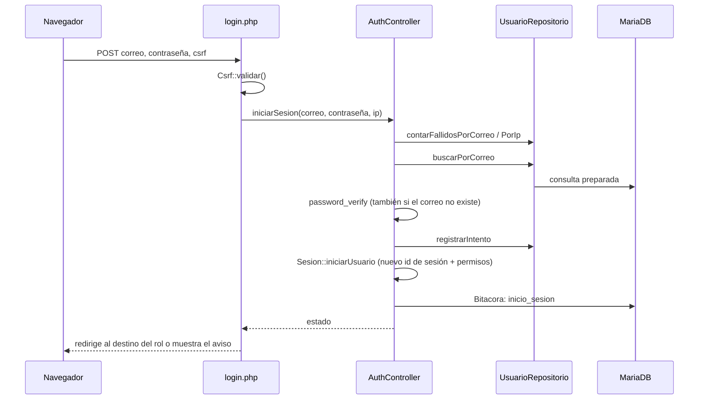
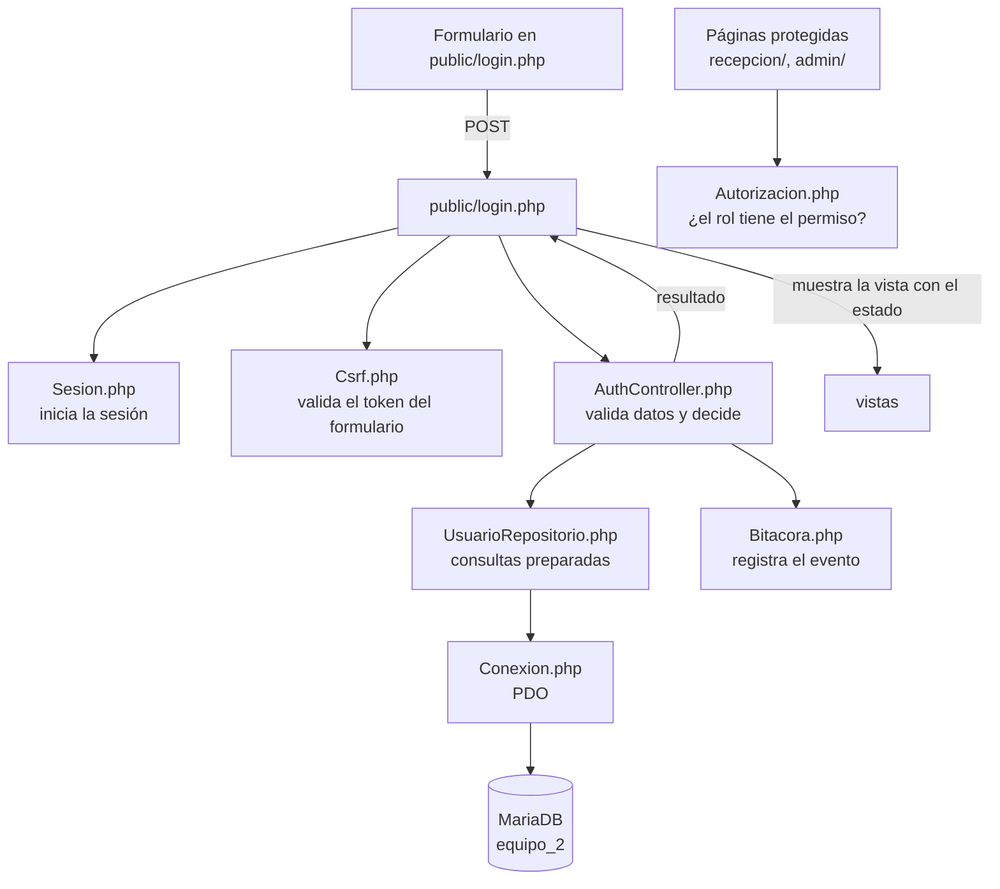
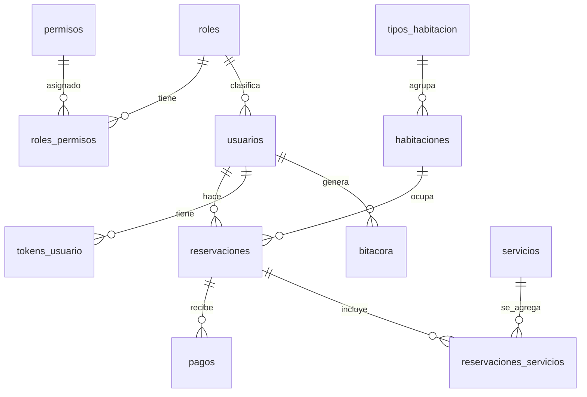

# Documentación del proyecto: Sistema de reservaciones de hotel

Sistema web de reservaciones para un hotel boutique (nombre de ejemplo: **Casa Cantera**).
Hecho con **PHP**, **MariaDB**, **HTML5**, **JavaScript** y **Tailwind CSS v4**.

> **Estado actual:** el **inicio y cierre de sesión** y el **registro de clientes** funcionan con la base de datos
> (sesión segura, CSRF, límite de intentos, bitácora y permisos por rol). Las páginas internas son provisionales
> ("en construcción"). Verificación 2FA y recuperación de contraseña siguen como prototipo visual: no se envían correos.

---

## 1. Estructura de carpetas

```
hotel/
├── public/                  ← Única carpeta visible desde el navegador
│   ├── index.php            Portada del hotel
│   ├── login.php            Iniciar sesión
│   ├── verificacion_2fa.php Código de verificación (recepción y administración)
│   ├── registro.php         Crear cuenta
│   ├── recuperar_contrasena.php   Solicitar enlace de recuperación
│   ├── restablecer_contrasena.php Crear contraseña nueva desde el enlace
│   ├── aviso_privacidad.php Aviso de privacidad
│   ├── terminos.php         Términos y condiciones
│   ├── logout.php           Cerrar sesión (POST con token)
│   ├── mis_reservaciones.php Destino del cliente (provisional, protegida)
│   ├── recepcion/           panel.php (provisional, protegida); check_in y check_out vacíos
│   ├── admin/               habitaciones.php y usuarios.php (provisionales, protegidas); bitacora vacío
│   └── assets/
│       ├── css/entrada.css  Fuente de Tailwind (se edita)
│       ├── css/styles.css   CSS compilado (no se edita a mano)
│       ├── js/validation.js Validación de formularios e interacciones
│       └── img/             Fotografías del hotel
│
├── app/                     ← Código del servidor, no accesible desde el navegador
│   ├── config/config.php    Constantes y lectura de .env
│   ├── nucleo/              Conexion, Sesion, Csrf, Autorizacion, Bitacora
│   ├── controladores/       AuthController y UsuarioController (listos); Reservacion vacío
│   ├── repositorios/        UsuarioRepositorio (listo); Reservacion vacío
│   └── vistas/              Fragmentos HTML reutilizables
│
├── database/
│   ├── esquema.sql          Tablas, roles, permisos, procedimiento y triggers
│   └── datos_prueba.sql     Usuarios de prueba (uno por rol)
│
├── storage/logs/, storage/respaldos/   Archivos generados por el sistema
├── docs/                    Esta documentación
├── tests/                   Pruebas sin base de datos: prueba_auth.php, prueba_registro.php
│                            y dobles_prueba.php (repositorio y bitácora simulados)
├── .env / .env.example      Credenciales (.env no se sube a Git)
├── .htaccess                Envía todas las peticiones a public/
└── package.json             Scripts para compilar Tailwind
```

---

## 2. Cómo llega una petición



1. Apache recibe `localhost/hotel/...`.
2. El `.htaccess` de la raíz reescribe la ruta hacia `public/`. Por eso `app/`, `database/`, `storage/` y `.env`
   nunca se pueden abrir desde el navegador.
3. `public/index.php` (o la página pedida) carga `config.php`, que lee `.env` y define las constantes.
4. La página arma el HTML incluyendo las vistas de `app/vistas/`.
5. El navegador descarga `styles.css` y `validation.js`.

Al entrar a `localhost/hotel/` sin página, Apache sirve `public/index.php` (la portada).

---

## 3. Quién llama a quién (estado actual)

### 3.1 Todas las páginas

Toda página de `public/` empieza y termina igual:

```
config.php  →  encabezado.php  →  [contenido de la página]  →  pie.php
```

| Archivo | Qué hace |
|---|---|
| `app/config/config.php` | Define `NOMBRE_HOTEL`, lee `.env` → `DB_HOST`, `DB_PUERTO`, `DB_NOMBRE`, `DB_USUARIO`, `DB_CONTRASENA` y registra la carga automática de clases de `nucleo/`, `controladores/` y `repositorios/`. Si falta `.env`, detiene la página con un mensaje claro. |
| `app/vistas/encabezado.php` | `<!doctype>`, `<head>` (título con `$tituloPagina`, fuentes, `styles.css`), apertura de `<body>` y enlace "Saltar al contenido". Las páginas en subcarpetas definen `$rutaBase = '../'` antes de incluirlo. |
| `app/vistas/pie.php` | Carga `validation.js` y cierra `</body></html>`. |

### 3.2 Páginas del sitio público

`index.php`, `aviso_privacidad.php`, `terminos.php`



| Vista | Qué hace | Variables que recibe |
|---|---|---|
| `cabecera_sitio.php` | Barra superior: logotipo, menú, "Iniciar sesión", "Reservar" y menú móvil. Define `$enlacesSitio` y `$rutaInicio`. | — |
| `pie_sitio.php` | Pie oscuro con secciones, enlaces de cuenta y legales. | Usa `$enlacesSitio` y `$rutaInicio` de la cabecera. |
| `documento_legal.php` | Título, fecha, índice lateral y secciones de un documento largo. | `$tituloDocumento`, `$fechaActualizacion`, `$introduccion`, `$secciones` |

`index.php` define en arreglos el contenido de ejemplo (`$habitaciones`, `$servicios`, `$galeria`, `$opiniones`,
`$preguntas`), que en el futuro vendrá de la base de datos.

### 3.3 Pantallas de acceso

`login.php`, `verificacion_2fa.php`, `registro.php`, `recuperar_contrasena.php`, `restablecer_contrasena.php`



| Vista | Qué hace | Variables que recibe |
|---|---|---|
| `acceso_inicio.php` | Abre el marco de dos columnas: panel naranja con el hotel y columna del formulario. | — |
| `aviso.php` | Muestra el mensaje de estado (error o éxito). | `$aviso = ['tono', 'titulo', 'texto']` o `null` |
| `acceso_fin.php` | Enlaces legales y cierre del marco. | — |

Cada pantalla define `$avisos` (los mensajes posibles).
- En **`login.php`** el estado lo decide `AuthController`. Por la URL solo se aceptan `sesion_cerrada` y
  `acceso_requerido`, que llegan por redirección.
- En **`registro.php`** lo decide `UsuarioController`, que además devuelve un mensaje por campo.
- En las demás pantallas de acceso el estado todavía se simula con `$_GET['estado']`.

### 3.4 Flujo entre pantallas de acceso



Las líneas punteadas aún no funcionan: dependen del envío de correos, que por ahora no se implementa.

### 3.5 JavaScript: `public/assets/js/validation.js`

Se carga en todas las páginas y actúa según atributos del HTML:

| Atributo en el HTML | Comportamiento |
|---|---|
| `form[data-validar]` | Valida al enviar; muestra el error en `#error-{id del campo}` y enfoca el primer campo inválido. |
| `data-error-vacio` | Mensaje si el campo obligatorio está vacío. |
| `data-error-formato` | Mensaje si el formato no es válido (correo, patrón o longitud mínima). |
| `data-igual-a="id"` + `data-error-coincidencia` | El valor debe ser igual al de otro campo (confirmar contraseña). |
| `data-despues-de="id"` + `data-error-orden` | La fecha debe ser posterior a la de otro campo (salida después de llegada). |
| `data-prototipo-destino` | **Solo prototipo:** simula el envío y redirige. Se quita al conectar los controladores. |
| `[data-alternar-contrasena="id"]` | Botón para mostrar u ocultar una contraseña. |
| `input[data-solo-digitos]` | Elimina lo que no sea número (código 2FA). |
| `details[data-menu]` | Cierra el menú móvil al elegir una sección. |

La validación del navegador es solo para comodidad del usuario. **El servidor debe volver a validar todo.**

### 3.6 Estilos: Tailwind CSS

```
entrada.css  ──(npm run css:compilar)──►  styles.css  ◄── encabezado.php lo carga
```

- `entrada.css` define los colores, las fuentes (`@theme`) y las clases reutilizables: `.campo-texto`,
  `.etiqueta-campo`, `.error-campo`, `.boton-principal`, `.enlace`.
- Tailwind revisa los `.php` de `public/` y `app/` y el JS para generar solo las clases que se usan.
- **Después de cambiar clases en cualquier archivo hay que recompilar.**

| Token | Color | Uso |
|---|---|---|
| `ostion` | `#FAFAFA` | Fondo |
| `cal` | `#EEEEEF` | Campos y secciones alternas |
| `linea` | `#CDCDCF` | Bordes y divisores |
| `piedra` | `#939599` | Bordes al pasar el cursor, textos de relleno |
| `musgo` | `#5E6066` | Texto secundario |
| `tinta` | `#17181B` | Texto principal y fondos oscuros |
| `naranja` / `naranja-hover` | `#FF6119` / `#FF7A3D` | Color principal |
| `turquesa` | `#2BCFCE` | Acento secundario |
| `alerta` / `exito` | `#C0183A` / `#0F766E` | Mensajes de error y éxito |

---

## 4. Inicio de sesión (implementado)



| Regla | Detalle |
|---|---|
| Mensajes neutros | Correo inexistente y contraseña incorrecta dan el mismo mensaje y tardan lo mismo. "Cuenta desactivada" y "sin habilitar" solo aparecen con la contraseña correcta. |
| Límite de intentos | 5 fallos por correo o 20 por IP en 15 minutos bloquean temporalmente (`intentos_login`). Un acceso correcto reinicia el contador del correo. |
| Sesión | Cookie `sesion_hotel` con `HttpOnly` y `SameSite=Lax` (`Secure` con HTTPS), nuevo identificador al entrar y cierre tras 30 minutos de inactividad. |
| CSRF | Login y logout exigen el token del formulario. El logout solo acepta POST. |
| Contraseñas | `password_verify`; si el hash usa un costo antiguo se actualiza solo (`password_needs_rehash`). |
| Permisos | Al entrar se guardan en la sesión los permisos del rol. `Autorizacion::requerirPermiso()` redirige al login sin sesión y responde 403 sin permiso. |
| Bitácora | `inicio_sesion`, `cierre_sesion`, `acceso_cuenta_inactiva`, `registro_usuario`. |
| Sin base de datos | El login muestra "El sistema no está disponible" y registra el error en el log de PHP. |

### Registro

`registro.php` → `UsuarioController::registrar($_POST)`:

1. Valida en el servidor: nombre (máx. 60), apellidos (máx. 80), correo válido (máx. 254), teléfono opcional
   (7 a 20: números, espacios y `+ ( ) -`), contraseña de 8 a 72 caracteres, confirmación igual y términos aceptados.
2. Si el correo ya existe, responde "Ya existe una cuenta con este correo". Sin verificación por correo no es
   posible ocultarlo e iniciar la sesión del nuevo usuario a la vez.
3. Crea el usuario con rol **cliente**, activo y habilitado (`esta_verificado = TRUE`, no hay correo de confirmación),
   con la contraseña cifrada por `password_hash`.
4. Registra `registro_usuario` en la bitácora, inicia la sesión y lleva a `mis_reservaciones.php`.

Si hay errores, la página vuelve a mostrar los datos escritos (nunca las contraseñas) y el mensaje junto a cada campo.
Los repositorios abren la conexión en la primera consulta, así que los errores del formulario se muestran aunque
la base de datos no responda.

Destino por rol: cliente → `mis_reservaciones.php`; recepcionista → `recepcion/panel.php`;
administrador → `admin/habitaciones.php`; superadministrador → `admin/usuarios.php`.

Proteger una página nueva:

```php
<?php
$rutaBase = '../';                                   // '' si está en public/
require __DIR__ . '/../../app/config/config.php';
$usuario = Autorizacion::requerirPermiso('gestionar_pagos', $rutaBase);
```

### Arquitectura general

El mismo patrón se usará para el resto de la lógica:



| Capa | Archivos | Responsabilidad |
|---|---|---|
| Páginas | `public/*.php` | Reciben la petición, llaman al controlador y muestran la vista. |
| Controladores | `AuthController`, `UsuarioController`, `ReservacionController` | Validan datos en el servidor y aplican las reglas del negocio. No escriben SQL. |
| Repositorios | `UsuarioRepositorio`, `ReservacionRepositorio` | Únicos que escriben SQL, siempre con consultas preparadas. |
| Núcleo | `Conexion`, `Sesion`, `Csrf`, `Autorizacion`, `Bitacora` | Servicios compartidos. Todos implementados. |

`Conexion::obtener()` devuelve una conexión PDO única, con errores como excepciones, resultados como arreglos
asociativos y consultas preparadas reales.

---

## 5. Base de datos (`database/esquema.sql`)



`intentos_login` no tiene relaciones: guarda correo, IP y resultado para limitar intentos de acceso.

### Roles

| Rol | 2FA | Permisos | Uso |
|---|---|---|---|
| `invitado` | No | 4 | Visitante sin cuenta |
| `cliente` | No | 7 | Reserva y consulta sus reservaciones |
| `recepcionista` | Sí | 9 | Entradas, salidas, reservaciones y cobros |
| `administrador` | Sí | 14 | Operación del hotel |
| `superadministrador` | Sí | 24 (todos) | Control total |

### Reglas de integridad

- **No se borra, se desactiva:** las llaves foráneas usan `ON DELETE RESTRICT`.
  `usuarios.esta_activo`, `habitaciones.esta_activa` y `servicios.esta_activo` sirven para "eliminar".
- La **bitácora** usa `ON DELETE SET NULL` para conservar el historial.
- **Validaciones `CHECK`:** capacidad y precios positivos, salida después de entrada, personas y montos mayores que cero.
- **Procedimiento `validar_reservacion`** (llamado por los triggers `validar_reservacion_insert` y `_update`):
  - habitación existente y activa, sin superar la capacidad (al crear o al cambiar habitación o personas);
  - evita reservar la misma habitación en fechas que se cruzan, también si dos personas reservan al mismo tiempo.
- `tokens_usuario` guarda solo el hash SHA-256 de los tokens de recuperación, verificación de correo y
  "mantener la sesión iniciada".

---

## 6. Instalación

### Desarrollo (laptop, sin base de datos)

```bash
npm install
npm run css:compilar        # o: npm run css:vigilar
php -S localhost:8000 -t public
```

Abrir `http://localhost:8000`.

### Servidor con XAMPP

1. Clonar en `htdocs`:
   ```bash
   cd /opt/lampp/htdocs        # Windows: C:\xampp\htdocs
   git clone https://github.com/Omar-art32/hotel.git
   ```
2. En phpMyAdmin, como `root`, importar `database/esquema.sql`.
3. Crear el usuario de la aplicación (si no existe), con permisos limitados:
   ```sql
   CREATE USER 'usuario_equipo_2'@'localhost' IDENTIFIED BY '...';
   GRANT SELECT, INSERT, UPDATE, DELETE, EXECUTE ON equipo_2.* TO 'usuario_equipo_2'@'localhost';
   ```
4. Copiar `.env.example` como `.env` y completar los valores.
5. Opcional, para probar: importar `database/datos_prueba.sql`. Crea un usuario por rol
   (`superadmin@hotel.test`, `admin@hotel.test`, `recepcion@hotel.test`, `cliente@hotel.test`, además de
   `inactivo@hotel.test` y `sin.verificar@hotel.test`), todos con la contraseña `Hotel#2026`.
6. Abrir `http://localhost/hotel` en el servidor, o `http://IP-DEL-SERVIDOR/hotel` desde otra computadora.

El CSS compilado está en el repositorio, así que el servidor no necesita Node.js.

### Pruebas automáticas

```bash
php tests/prueba_auth.php       # login, límite de intentos, sesión, CSRF
php tests/prueba_registro.php   # validaciones, correo duplicado, alta y sesión
```

Usan una base de datos simulada (`tests/dobles_prueba.php`).
Las consultas SQL reales se prueban iniciando sesión en XAMPP con los usuarios de prueba.

### Ver los estados del prototipo

| Página | Estados (`?estado=`) |
|---|---|
| `verificacion_2fa.php` | `codigo_incorrecto`, `exito` |
| `recuperar_contrasena.php` | `conexion`, `exito` |
| `restablecer_contrasena.php` | `token_invalido`, `conexion`, `exito` |

---

## 7. Convenciones

| Elemento | Convención | Ejemplo |
|---|---|---|
| Identificadores | Español, sin acentos ni ñ | `contrasena`, `reservacion` |
| Archivos y carpetas | snake_case | `recuperar_contrasena.php` |
| Variables y funciones JavaScript | camelCase | `mostrarError()` |
| Clases CSS e `id` de HTML | kebab-case | `campo-texto`, `error-correo` |
| Clases PHP | PascalCase | `Conexion`, `AuthController` |
| Variables y funciones PHP | camelCase | `$tituloPagina` |
| Tablas y columnas | snake_case | `tokens_usuario.fecha_expiracion` |
| Textos visibles | Español correcto, con acentos | "Contraseña" |

---

## 8. Pendientes

**Lógica del servidor**
- Verificación en dos pasos para los roles con `requiere_2fa` (hoy el personal entra solo con contraseña).
- Recuperación de contraseña y verificación de correo (requieren envío de correos; fuera de alcance por ahora).
- "Mantener la sesión iniciada" con `tokens_usuario` (se quitó del login hasta implementarlo).
- `ReservacionController` y `ReservacionRepositorio`: disponibilidad, reservar y cancelar.
- Quitar `data-prototipo-destino` y `?estado=` de las pantallas que aún los usan.

**Páginas provisionales o vacías:** contenido real de `mis_reservaciones.php`, `recepcion/*` y `admin/*`.

**Contenido**
- Fotografías en `public/assets/img/` (nombres esperados en `index.php` y `acceso_inicio.php`).
- Completar los datos marcados en el aviso de privacidad y los términos, y que los revise una persona especialista.
