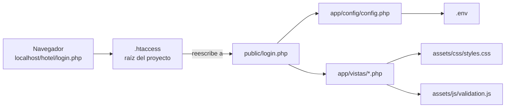
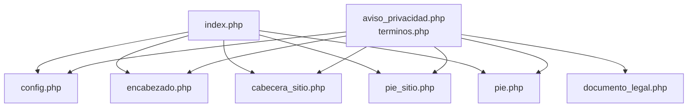
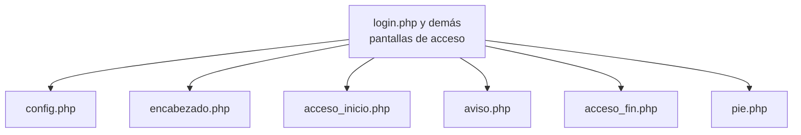
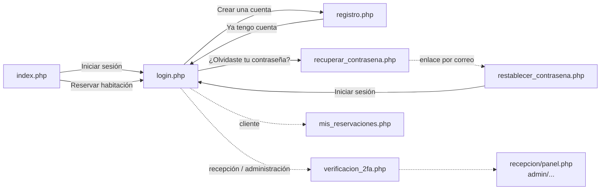
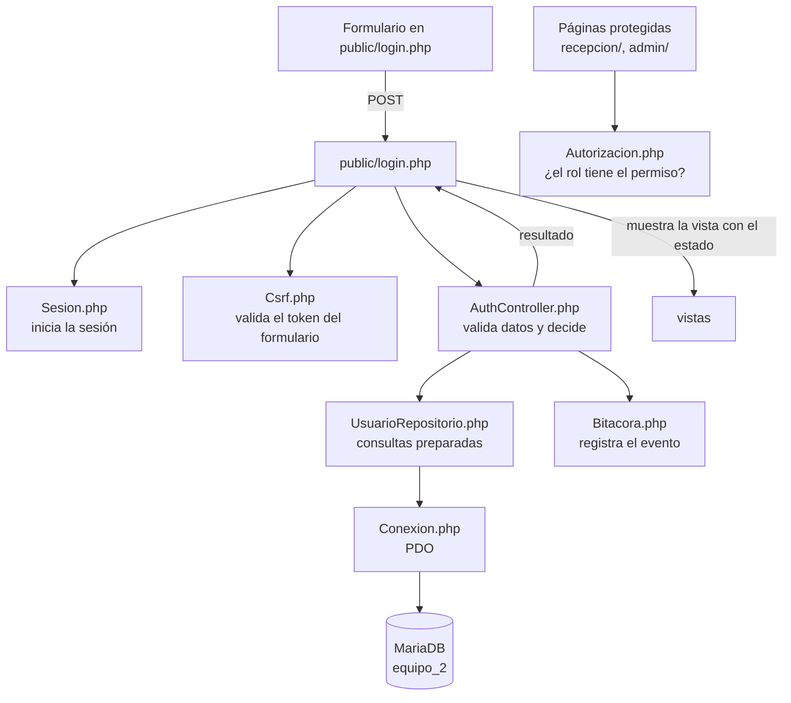
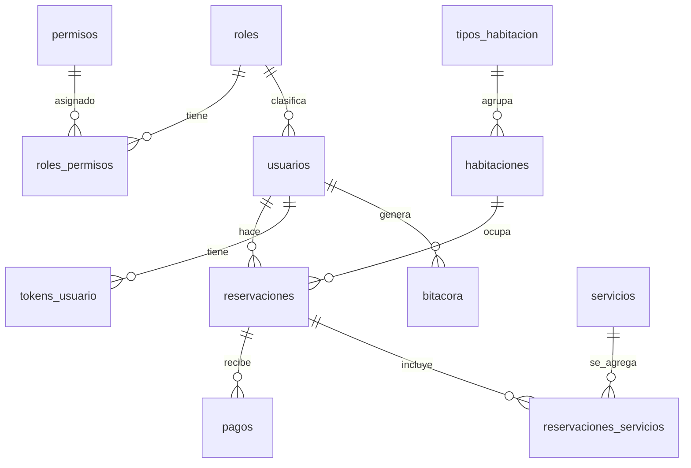

# Documentación del proyecto: Sistema de reservaciones de hotel

Sistema web de reservaciones para un hotel boutique (nombre de ejemplo: **Casa Cantera**).
Hecho con **PHP**, **MariaDB**, **HTML5**, **JavaScript** y **Tailwind CSS v4**.

> **Estado actual:** la interfaz está completa como prototipo visual. La base de datos está diseñada y existe la
> clase de conexión, pero **todavía no hay lógica de negocio**: controladores, repositorios, sesión, CSRF,
> autorización y bitácora son archivos vacíos. Las pantallas simulan sus estados con `?estado=...`.

---

## 1. Estructura de carpetas

```
hotel/
├── public/                  ← Única carpeta visible desde el navegador
│   ├── index.php            Portada del hotel
│   ├── login.php            Iniciar sesión
│   ├── verificacion_2fa.php Código de verificación (recepción y administración)
│   ├── registro.php         Crear cuenta
│   ├── recuperar_contrasena.php   Solicitar enlace de recuperación
│   ├── restablecer_contrasena.php Crear contraseña nueva desde el enlace
│   ├── aviso_privacidad.php Aviso de privacidad
│   ├── terminos.php         Términos y condiciones
│   ├── logout.php           (vacío) Cerrar sesión
│   ├── mis_reservaciones.php (vacío) Reservaciones del cliente
│   ├── recepcion/           (vacíos) panel, check_in, check_out
│   ├── admin/               (vacíos) habitaciones, usuarios, bitacora
│   └── assets/
│       ├── css/entrada.css  Fuente de Tailwind (se edita)
│       ├── css/styles.css   CSS compilado (no se edita a mano)
│       ├── js/validation.js Validación de formularios e interacciones
│       └── img/             Fotografías del hotel
│
├── app/                     ← Código del servidor, no accesible desde el navegador
│   ├── config/config.php    Constantes y lectura de .env
│   ├── nucleo/              Servicios base (Conexion listo; el resto vacío)
│   ├── controladores/       (vacíos) Reciben formularios y deciden qué hacer
│   ├── repositorios/        (vacíos) Consultas SQL
│   └── vistas/              Fragmentos HTML reutilizables
│
├── database/
│   ├── esquema.sql          Tablas, roles, permisos, procedimiento y triggers
│   └── datos_prueba.sql     (vacío) Datos de ejemplo
│
├── storage/logs/, storage/respaldos/   Archivos generados por el sistema
├── docs/                    Esta documentación
├── .env / .env.example      Credenciales (.env no se sube a Git)
├── .htaccess                Envía todas las peticiones a public/
└── package.json             Scripts para compilar Tailwind
```

---

## 2. Cómo llega una petición



1. Apache recibe `localhost/hotel/...`.
2. El `.htaccess` de la raíz reescribe la ruta hacia `public/`. Por eso `app/`, `database/`, `storage/` y `.env`
   nunca se pueden abrir desde el navegador.
3. `public/index.php` (o la página pedida) carga `config.php`, que lee `.env` y define las constantes.
4. La página arma el HTML incluyendo las vistas de `app/vistas/`.
5. El navegador descarga `styles.css` y `validation.js`.

Al entrar a `localhost/hotel/` sin página, Apache sirve `public/index.php` (la portada).

---

## 3. Quién llama a quién (estado actual)

### 3.1 Todas las páginas

Toda página de `public/` empieza y termina igual:

```
config.php  →  encabezado.php  →  [contenido de la página]  →  pie.php
```

| Archivo | Qué hace |
|---|---|
| `app/config/config.php` | Define `NOMBRE_HOTEL` y lee `.env` → `DB_HOST`, `DB_PUERTO`, `DB_NOMBRE`, `DB_USUARIO`, `DB_CONTRASENA`. Si falta `.env`, detiene la página con un mensaje claro. |
| `app/vistas/encabezado.php` | `<!doctype>`, `<head>` (título con `$tituloPagina`, fuentes, `styles.css`), apertura de `<body>` y enlace "Saltar al contenido". |
| `app/vistas/pie.php` | Carga `validation.js` y cierra `</body></html>`. |

### 3.2 Páginas del sitio público

`index.php`, `aviso_privacidad.php`, `terminos.php`



| Vista | Qué hace | Variables que recibe |
|---|---|---|
| `cabecera_sitio.php` | Barra superior: logotipo, menú, "Iniciar sesión", "Reservar" y menú móvil. Define `$enlacesSitio` y `$rutaInicio`. | — |
| `pie_sitio.php` | Pie oscuro con secciones, enlaces de cuenta y legales. | Usa `$enlacesSitio` y `$rutaInicio` de la cabecera. |
| `documento_legal.php` | Título, fecha, índice lateral y secciones de un documento largo. | `$tituloDocumento`, `$fechaActualizacion`, `$introduccion`, `$secciones` |

`index.php` define en arreglos el contenido de ejemplo (`$habitaciones`, `$servicios`, `$galeria`, `$opiniones`,
`$preguntas`), que en el futuro vendrá de la base de datos.

### 3.3 Pantallas de acceso

`login.php`, `verificacion_2fa.php`, `registro.php`, `recuperar_contrasena.php`, `restablecer_contrasena.php`



| Vista | Qué hace | Variables que recibe |
|---|---|---|
| `acceso_inicio.php` | Abre el marco de dos columnas: panel naranja con el hotel y columna del formulario. | — |
| `aviso.php` | Muestra el mensaje de estado (error o éxito). | `$aviso = ['tono', 'titulo', 'texto']` o `null` |
| `acceso_fin.php` | Enlaces legales y cierre del marco. | — |

Cada pantalla define `$avisos` (los mensajes posibles) y elige uno con `$_GET['estado']`.
**Esto es solo del prototipo**: cuando existan los controladores, ellos decidirán el estado.

### 3.4 Flujo entre pantallas de acceso



Las líneas punteadas aún no funcionan: dependen de la lógica del servidor.

### 3.5 JavaScript: `public/assets/js/validation.js`

Se carga en todas las páginas y actúa según atributos del HTML:

| Atributo en el HTML | Comportamiento |
|---|---|
| `form[data-validar]` | Valida al enviar; muestra el error en `#error-{id del campo}` y enfoca el primer campo inválido. |
| `data-error-vacio` | Mensaje si el campo obligatorio está vacío. |
| `data-error-formato` | Mensaje si el formato no es válido (correo, patrón o longitud mínima). |
| `data-igual-a="id"` + `data-error-coincidencia` | El valor debe ser igual al de otro campo (confirmar contraseña). |
| `data-despues-de="id"` + `data-error-orden` | La fecha debe ser posterior a la de otro campo (salida después de llegada). |
| `data-prototipo-destino` | **Solo prototipo:** simula el envío y redirige. Se quita al conectar los controladores. |
| `[data-alternar-contrasena="id"]` | Botón para mostrar u ocultar una contraseña. |
| `input[data-solo-digitos]` | Elimina lo que no sea número (código 2FA). |
| `details[data-menu]` | Cierra el menú móvil al elegir una sección. |

La validación del navegador es solo para comodidad del usuario. **El servidor debe volver a validar todo.**

### 3.6 Estilos: Tailwind CSS

```
entrada.css  ──(npm run css:compilar)──►  styles.css  ◄── encabezado.php lo carga
```

- `entrada.css` define los colores, las fuentes (`@theme`) y las clases reutilizables: `.campo-texto`,
  `.etiqueta-campo`, `.error-campo`, `.boton-principal`, `.enlace`.
- Tailwind revisa los `.php` de `public/` y `app/` y el JS para generar solo las clases que se usan.
- **Después de cambiar clases en cualquier archivo hay que recompilar.**

| Token | Color | Uso |
|---|---|---|
| `ostion` | `#FAFAFA` | Fondo |
| `cal` | `#EEEEEF` | Campos y secciones alternas |
| `linea` | `#CDCDCF` | Bordes y divisores |
| `piedra` | `#939599` | Bordes al pasar el cursor, textos de relleno |
| `musgo` | `#5E6066` | Texto secundario |
| `tinta` | `#17181B` | Texto principal y fondos oscuros |
| `naranja` / `naranja-hover` | `#FF6119` / `#FF7A3D` | Color principal |
| `turquesa` | `#2BCFCE` | Acento secundario |
| `alerta` / `exito` | `#C0183A` / `#0F766E` | Mensajes de error y éxito |

---

## 4. Arquitectura prevista para la lógica (por implementar)

La estructura de carpetas ya separa las responsabilidades. El flujo esperado cuando se envíe un formulario es:



| Capa | Archivos | Responsabilidad |
|---|---|---|
| Páginas | `public/*.php` | Reciben la petición, llaman al controlador y muestran la vista. |
| Controladores | `AuthController`, `UsuarioController`, `ReservacionController` | Validan datos en el servidor y aplican las reglas del negocio. No escriben SQL. |
| Repositorios | `UsuarioRepositorio`, `ReservacionRepositorio` | Únicos que escriben SQL, siempre con consultas preparadas. |
| Núcleo | `Conexion` ✅, `Sesion`, `Csrf`, `Autorizacion`, `Bitacora` | Servicios compartidos. |

**Ya implementado:** `Conexion::obtener()` devuelve una conexión PDO única, con errores como excepciones,
resultados como arreglos asociativos y consultas preparadas reales. Ninguna página la usa todavía.

---

## 5. Base de datos (`database/esquema.sql`)



`intentos_login` no tiene relaciones: guarda correo, IP y resultado para limitar intentos de acceso.

### Roles

| Rol | 2FA | Permisos | Uso |
|---|---|---|---|
| `invitado` | No | 4 | Visitante sin cuenta |
| `cliente` | No | 7 | Reserva y consulta sus reservaciones |
| `recepcionista` | Sí | 9 | Entradas, salidas, reservaciones y cobros |
| `administrador` | Sí | 14 | Operación del hotel |
| `superadministrador` | Sí | 24 (todos) | Control total |

### Reglas de integridad

- **No se borra, se desactiva:** las llaves foráneas usan `ON DELETE RESTRICT`.
  `usuarios.esta_activo`, `habitaciones.esta_activa` y `servicios.esta_activo` sirven para "eliminar".
- La **bitácora** usa `ON DELETE SET NULL` para conservar el historial.
- **Validaciones `CHECK`:** capacidad y precios positivos, salida después de entrada, personas y montos mayores que cero.
- **Procedimiento `validar_reservacion`** (llamado por los triggers `validar_reservacion_insert` y `_update`):
  - habitación existente y activa, sin superar la capacidad (al crear o al cambiar habitación o personas);
  - evita reservar la misma habitación en fechas que se cruzan, también si dos personas reservan al mismo tiempo.
- `tokens_usuario` guarda solo el hash SHA-256 de los tokens de recuperación, verificación de correo y
  "mantener la sesión iniciada".

---

## 6. Instalación

### Desarrollo (laptop, sin base de datos)

```bash
npm install
npm run css:compilar        # o: npm run css:vigilar
php -S localhost:8000 -t public
```

Abrir `http://localhost:8000`.

### Servidor con XAMPP

1. Clonar en `htdocs`:
   ```bash
   cd /opt/lampp/htdocs        # Windows: C:\xampp\htdocs
   git clone https://github.com/Omar-art32/hotel.git
   ```
2. En phpMyAdmin, como `root`, importar `database/esquema.sql`.
3. Crear el usuario de la aplicación (si no existe), con permisos limitados:
   ```sql
   CREATE USER 'usuario_equipo_2'@'localhost' IDENTIFIED BY '...';
   GRANT SELECT, INSERT, UPDATE, DELETE, EXECUTE ON equipo_2.* TO 'usuario_equipo_2'@'localhost';
   ```
4. Copiar `.env.example` como `.env` y completar los valores.
5. Abrir `http://localhost/hotel` en el servidor, o `http://IP-DEL-SERVIDOR/hotel` desde otra computadora.

El CSS compilado está en el repositorio, así que el servidor no necesita Node.js.

### Ver los estados del prototipo

| Página | Estados (`?estado=`) |
|---|---|
| `login.php` | `credenciales`, `bloqueada`, `sin_verificar`, `conexion`, `exito` |
| `verificacion_2fa.php` | `codigo_incorrecto`, `exito` |
| `registro.php` | `conexion`, `exito` |
| `recuperar_contrasena.php` | `conexion`, `exito` |
| `restablecer_contrasena.php` | `token_invalido`, `conexion`, `exito` |

---

## 7. Convenciones

| Elemento | Convención | Ejemplo |
|---|---|---|
| Identificadores | Español, sin acentos ni ñ | `contrasena`, `reservacion` |
| Archivos y carpetas | snake_case | `recuperar_contrasena.php` |
| Variables y funciones JavaScript | camelCase | `mostrarError()` |
| Clases CSS e `id` de HTML | kebab-case | `campo-texto`, `error-correo` |
| Clases PHP | PascalCase | `Conexion`, `AuthController` |
| Variables y funciones PHP | camelCase | `$tituloPagina` |
| Tablas y columnas | snake_case | `tokens_usuario.fecha_expiracion` |
| Textos visibles | Español correcto, con acentos | "Contraseña" |

---

## 8. Pendientes

**Lógica del servidor**
- `Sesion`, `Csrf`, `Autorizacion` y `Bitacora` (núcleo).
- `AuthController`: login con `password_verify`, límite de intentos con `intentos_login`, 2FA para los roles con
  `requiere_2fa`, recuperación de contraseña con `tokens_usuario`.
- `UsuarioController`: registro con `password_hash`, verificación de correo.
- `ReservacionController`: disponibilidad, reservar y cancelar.
- Repositorios con consultas preparadas.
- Quitar `data-prototipo-destino` de los formularios y la selección de estado por `?estado=`.

**Páginas vacías:** `logout.php`, `mis_reservaciones.php`, `recepcion/*`, `admin/*`.

**Contenido**
- Datos de prueba en `datos_prueba.sql`, incluido un superadministrador inicial.
- Fotografías en `public/assets/img/` (nombres esperados en `index.php` y `acceso_inicio.php`).
- Completar los datos marcados en el aviso de privacidad y los términos, y que los revise una persona especialista.
- Rutas de `encabezado.php`: solo funcionan para páginas en la raíz de `public/`; ajustarlas al crear
  `recepcion/` y `admin/`.
